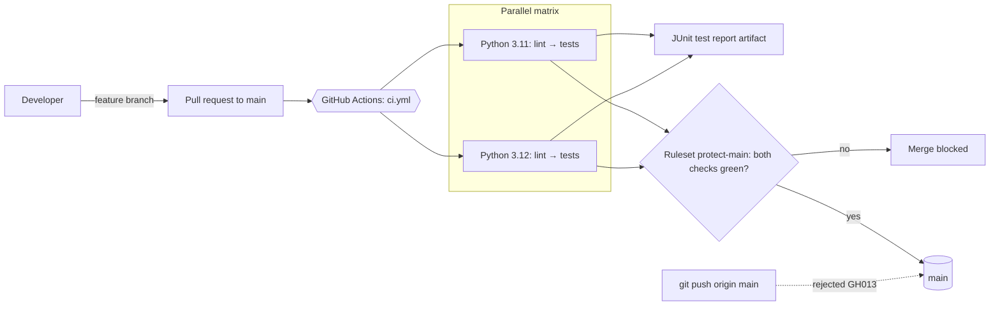

# ShopKart API – CI Pipeline with Quality Gates


## 1. What this project is about

| | |
|---|---|
| **Business problem** | A small e-commerce team pushed code straight to `main`. Broken and untested code reached production, and nobody found out until users did. |
| **What I delivered** | A GitHub Actions CI pipeline (lint + unit tests on Python 3.11 and 3.12) enforced by a branch ruleset. Every change must come through a pull request with green checks. |
| **Outcome** | Unchecked code cannot reach `main` (direct pushes are rejected) · lint and test failures block merges · feedback in ~1–2 min · test reports kept as artifacts for diagnosis |
| **My role** | Sole DevOps engineer: design, build, break-test and document |
| **Tech** | Python/Flask, pytest, flake8, GitHub Actions, GitHub rulesets, Git, AWS EC2 (build workstation), AWS Systems Manager, CloudWatch, EventBridge |
| **Status** | ✅ Complete (23 Nov 2026). Foundation for the next stage: [Secure Delivery Pipeline](#9-what-comes-next) (build, scan, deploy) |

---

## 2. Architecture



**In plain words:** a pull request triggers two identical jobs, one on each Python version. Each job runs the cheap check first (lint), then the unit tests, and saves a test report. The `protect-main` ruleset only allows the merge when both jobs are green.

---

## 3. What I did (step by step)

| # | Phase | What I implemented | Why | Evidence |
|---|---|---|---|---|
| 1 | Build workstation | Ubuntu EC2 workstation reached through **Session Manager** (no SSH port open), with a CloudWatch alarm that stops it after 1 h of low CPU and a nightly EventBridge stop | Secure access without keys; no surprise AWS bills | `docs/screenshots/01-workstation.png` |
| 2 | Application | Flask API (`/health`, `/products`, `/products/<id>`), 3 pytest unit tests, flake8 linting, pinned dependencies | Something real and testable to protect | `docs/screenshots/02-tests-local.png` |
| 3 | CI workflow | `.github/workflows/ci.yml`: PR + push triggers, Python 3.11/3.12 matrix, pip cache, lint → test, JUnit report artifact, read-only token, concurrency, 10-min timeout | Fast, repeatable, least-privilege checks on every change | `docs/screenshots/03-pipeline-green.png` |
| 4 | Enforcement | Ruleset `protect-main`: PR required, both test checks required, no force pushes, no deletion | A pipeline nobody is forced to pass is only a suggestion | `docs/screenshots/04-ruleset.png` |
| 5 | Break tests | Direct push, lint failure and failing test, each run on purpose | Prove the gates work, not just that the pipeline runs | screenshots 05–07 |

---

## 4. How it works (pipeline walkthrough)

1. A developer creates a feature branch and opens a pull request to `main`.
2. `ci.yml` starts two jobs in parallel (Python **3.11** and **3.12**).
3. Each job checks out the code, sets up Python with a **pip cache**, and installs the pinned dependencies.
4. **Lint first** (`flake8`): style and error checks take seconds, so the job fails fast before spending time on tests.
5. **Unit tests** (`pytest`) run and write a **JUnit XML report**, uploaded as an artifact so anyone can see which test failed and why.
6. The **`protect-main` ruleset** requires both test checks to pass before the merge button works.
7. If a newer commit is pushed to the same PR, **concurrency** cancels the outdated run, so no runner time is wasted.
8. The workflow token is **read-only** and jobs time out after **10 minutes**. A stuck or compromised job can't do damage or burn minutes.

### Key workflow settings and why

| Setting | Value | Why |
|---|---|---|
| Triggers | `pull_request` to `main`, `push` to `main` | Check every proposed change and confirm `main` after merge |
| Matrix | Python 3.11, 3.12 | Catch version-specific breakage before an upgrade surprises production |
| Cache | pip cache | Faster installs → faster feedback |
| Order | lint → tests | Fail fast: cheapest check first |
| Artifact | JUnit test report | Diagnose failures without re-running locally |
| `permissions` | `contents: read` | Least privilege for the CI token |
| `concurrency` | cancel in-progress runs for the same ref | Only the latest commit matters |
| `timeout-minutes` | 10 | Hung jobs don't block the queue |

---

## 5. Key decisions

| Decision | Chosen | Alternative | Why |
|---|---|---|---|
| CI platform | GitHub Actions | Jenkins, Azure Pipelines | Code already on GitHub; no server to run; same YAML concepts as Azure Pipelines |
| Enforcement | Repository **ruleset** | Classic branch protection | Rulesets are GitHub's newer model and also apply to admins |
| Merge strategy | Merge commits | Squash, rebase | Keeps the full PR history visible for review and audit |
| Remote auth | HTTPS + token (credential cache) | SSH keys | Simple on a short-lived cloud workstation |
| Workstation access | Session Manager | SSH on port 22 | No open inbound port, no keys to manage; access controlled by IAM |
| Version strategy | Pinned dependencies; CI matrix is the source of truth | Unpinned / "latest" | Reproducible builds; upgrade deliberately, not by accident |

### Same pattern I used in Azure DevOps (Warmworks)

| Azure DevOps | GitHub (this project) |
|---|---|
| `trigger` / `pr` | `on: push` / `on: pull_request` |
| `pool` (agent) | `runs-on` (runner) |
| Tasks | Actions / `run` steps |
| `dependsOn` | `needs` |
| Branch policies + build validation | Rulesets + required status checks |
| Pipeline artifacts / test results | `upload-artifact` + JUnit report |

---

## 6. Proof it works (tests I ran on purpose)

| # | Test | Expected | Result |
|---|---|---|---|
| 1 | `git push origin main` directly | Rejected by ruleset | ✅ Rejected with **GH013** (screenshot 05) |
| 2 | PR with an unused import | Lint fails, merge blocked | ✅ Failed at flake8 **F401**, merge blocked (screenshot 06) |
| 3 | PR with a wrong assertion | Tests fail, merge blocked | ✅ Failed `assert 3 == 4`; JUnit report pinpointed the test; fixed and merged when green (screenshot 07) |

### Real issues I hit and fixed (how I work when things break)

| # | What happened | Root cause | Fix / lesson |
|---|---|---|---|
| 1 | Auto-stop alarm stopped the workstation right after creation | CloudWatch evaluates the previous 30 min of data immediately | Tuned to 1 h below 2% CPU; added a nightly EventBridge stop |
| 2 | `EOF` / `cat >` lines ended up inside files | Heredoc wrapper pasted into an editor | Removed with `sed -i '/^EOF$/d'`; learned when to use a heredoc vs an editor |
| 3 | `ModuleNotFoundError: No module named 'flask'` | pytest ran on system Python; venv not active | `source .venv/bin/activate`; verify with `which python` |
| 4 | Duplicate `pytest.ini` / `requirements` committed inside `tests/` | Files created from the wrong directory | `git rm` the duplicates; check `pwd` before creating files |
| 5 | Workstation has Python 3.14, CI tests 3.11/3.12 | Newer OS than the pinned versions | Kept pins; CI matrix is the source of truth; bump only when needed |

---

## 7. Run it yourself

```bash
git clone https://github.com/sahil730/shopkart-api.git
cd shopkart-api
python3 -m venv .venv && source .venv/bin/activate
pip install -r requirements.txt

flake8 .          # lint (same as CI)
pytest            # unit tests (same as CI)
flask --app app run --port 8000   # adjust if your entry point differs
curl -s localhost:8000/health
```

**To contribute:** create a branch → commit → open a PR. The checks run automatically; the merge unlocks when both Python versions are green.

---

## 8. Security & cost

- **Least privilege:** CI token is read-only; jobs time out after 10 minutes.
- **No bypass:** ruleset blocks direct pushes, force pushes and branch deletion, including for the owner.
- **No open ports:** the build workstation is reached through Session Manager; port 22 is closed.
- **Cost control:** GitHub-hosted runners (free for public repos); the workstation auto-stops when idle and every night; AWS budget alerts are on.

---

## 9. What I learned / what comes next

**What I learned**
- A CI pipeline only protects you when a **rule enforces it**. Rulesets turned the checks from optional to mandatory.
- **Break tests are part of the delivery.** Showing a blocked merge proves more than showing a green run.
- **Fail fast:** ordering cheap checks first and cancelling outdated runs keeps feedback around 1–2 minutes.
- The concepts carry over directly from Azure Pipelines. The YAML vocabulary changes, but the design questions stay the same.

**How I design a workflow (6 questions)**
1. When should it run? → `on:`
2. Minimum access? → `permissions:`
3. Which jobs, and which wait for others? → `jobs:` + `needs:`
4. Which machine and versions? → `runs-on:` + `strategy.matrix`
5. Which commands would I type by hand, in order? → `steps:`
6. What must survive the VM? → `upload-artifact` or a registry push

**What comes next**
1. **Secure Delivery Pipeline:** multi-stage non-root Docker image, Trivy vulnerability gate, SHA-tagged images in GHCR, keyless AWS deploys (OIDC + Systems Manager) with automatic rollback.
2. Infrastructure as code (Terraform + Ansible) and Kubernetes GitOps in the companion repos.

---

## Repository structure

```text
shopkart-api/
├── app.py                     # Flask API: /health, /products, /products/<id>
├── requirements.txt           # pinned dependencies
├── pytest.ini
├── tests/                     # 3 unit tests
├── .github/workflows/ci.yml   # CI quality gates
└── docs/screenshots/          # evidence for each phase and break test
```

---

## About me

**Sahil Subudhi** – Azure DevOps engineer (2+ years, UK) applying the same production patterns on AWS and GitHub.
Open to DevOps / Cloud roles in **Hyderabad & Bengaluru** · Freelance: CI/CD, Terraform, Docker/Kubernetes.
[LinkedIn](https://linkedin.com/in/sahil-subudhi-977468b3) · sahilsaiesh@hotmail.com
